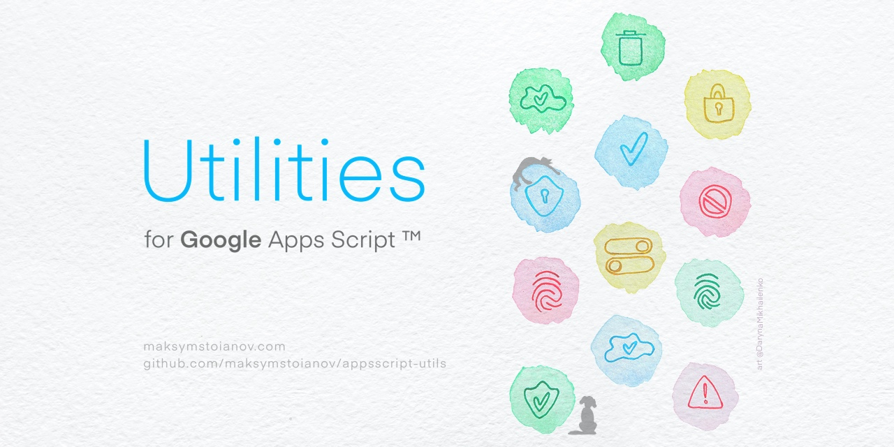

<a name="top"></a>



<p align="right">
    <small>
        <i>Художниця: <a href="https://darynamikhailenko.com/?utm_source=github&utm_medium=readme&utm_campaign=apps-script-utils&utm_content=banner-artist-credit" title="Портфоліо художниці Дарини Михайленко">Daryna Mikhailenko</a></i>
    </small>
</p>

[English](README.md) | **Українська** | [Русский](README.ru.md) | [Deutsch](README.de.md) | [Français](README.fr.md) | [Español](README.es.md) | [Português](README.pt.md) | [Italiano](README.it.md) | [Nederlands](README.nl.md) | [Polski](README.pl.md) | [Čeština](README.cs.md) | [Türkçe](README.tr.md) | [العربية](README.ar.md) | [Bahasa Indonesia](README.id.md) | [Tiếng Việt](README.vi.md) | [日本語](README.ja.md) | [한국어](README.ko.md) | [简体中文](README.zh.md) | [繁體中文](README.zh-TW.md)

> Цей переклад зроблено за допомогою ШІ з [README.md](README.md) для версії 2.1.1. Основною є англійська версія README; виправлення вітаються — див. [CONTRIBUTING.md](CONTRIBUTING.md#readme-translations).

# Утиліти для Google Apps Script™

<p align="left">
  <a href="https://www.npmjs.com/package/@bootgs/utils"></a>
  <a href="https://www.npmjs.com/package/@bootgs/utils"></a>
  <a href="https://github.com/google/clasp"></a>
  <a href="LICENSE"></a>
  <a href="SECURITY.md"></a>
  <a href="https://github.com/users/MaksymStoianov/projects/2/views/2"></a>
  <a href="https://github.com/bootgs/utils/releases"></a>
</p>

<p align="left">
  <a href="https://github.com/bootgs/utils/stargazers"></a>
  <a href="https://github.com/bootgs/utils/forks"></a>
  <a href="https://github.com/sponsors/MaksymStoianov"></a>
</p>

<!-- TOC -->

- [Утиліти для Google Apps Script™](#утиліти-для-google-apps-script)
  - [Огляд](#огляд)
  - [Ключові можливості](#ключові-можливості)
  - [Навички для ШІ-агентів](#навички-для-ші-агентів)
  - [Вимоги](#вимоги)
  - [Встановлення](#встановлення)
  - [Документація](#документація)
  - [Приклади використання](#приклади-використання)
  - [Розробка](#розробка)
    - [Скрипти](#скрипти)
    - [Тестування](#тестування)
  - [Структура проєкту](#структура-проєкту)
  - [Функції за категоріями](#функції-за-категоріями)
  - [Участь у розробці](#участь-у-розробці)
  - [Підтримка](#підтримка)
  - [Дорожня карта](#дорожня-карта)
  - [Журнал змін](#журнал-змін)
  - [Ліцензія](#ліцензія)
  <!-- TOC -->

## Огляд

**@bootgs/utils** — це бібліотека утиліт на TypeScript, створена спеціально для **Google Apps Script**. Вона
збирає в одному добре задокументованому й повністю протестованому пакеті допоміжні функції, які кожен GAS-проєкт
рано чи пізно пише вручну: роботу з таблицями та нотацією A1, перевірку типів і значень (`isX`/`nonX`/`requireX`),
перетворення рядків і масивів, типізовані винятки тощо.

## Ключові можливості

- **Створено для Google Apps Script** — спроєктовано з урахуванням середовища виконання GAS та його обмежень, а не
  адаптовано з універсальної бібліотеки для Node.js.
- **Широке покриття утилітами** — допоміжні функції для таблиць, UI, мережі й Admin SDK поряд з універсальними
  утилітами для рядків, масивів і об'єктів.
- **TypeScript передусім** — кожна функція має повні визначення типів для автодоповнення в IDE та безпеки на етапі
  компіляції.
- **Протестовано** — покрито набором модульних тестів на Vitest.
- **Довідкова документація з посиланнями** — кожен тип Google Apps Script, що використовується в API, посилається
  безпосередньо на свою офіційну документацію.
- **Послідовна обробка помилок** — окрема ієрархія класів винятків замінює довільно кинуті помилки.

## Навички для ШІ-агентів

Для команд, які користуються ШІ-агентом для програмування (Claude Code, Gemini CLI та інші), репозиторій
[bootgs/skills](https://github.com/bootgs/skills) надає Agent Skill
[`@bootgs/utils`](https://github.com/bootgs/skills/tree/main/skills/apps-script-utils), що описує цю бібліотеку
для таких агентів: домовленість про перевірки `isX`/`nonX`/`requireX`, допоміжні функції для нотації A1 і аркушів,
для рядків, чисел і масивів, типізовані винятки, а також допоміжні функції для HTML, JSON і шляхів.

Встановлення в Claude Code:

```bash
/plugin marketplace add bootgs/skills
/plugin install apps-script-utils@bootgs-skills
```

Встановлення через CLI `npx skills`, який підтримує різні агенти:

```bash
npx skills add bootgs/skills --skill apps-script-utils
```

Після встановлення агент застосовує навичку автоматично, коли завдання стосується цієї бібліотеки.

## Вимоги

- [Node.js](https://nodejs.org/) v22.14.0 або новіший
- [npm](https://www.npmjs.com/) (або інший менеджер пакетів для Node, наприклад pnpm)

## Встановлення

Встановіть пакет через npm:

```bash
npm install @bootgs/utils
```

## Документація

Повна документація опублікована за адресою **<https://bootgs.github.io/utils/uk/>** — посібники,
огляди окремих модулів і повний довідник функцій. Її джерело лежить у [`docs/writerside-uk/`](docs/writerside-uk/) і
перезбирається після кожного push у `main`.

Рекомендований порядок читання:

- [Перші кроки](https://bootgs.github.io/utils/uk/getting-started.html)
- [Домовленості про перевірки](https://bootgs.github.io/utils/uk/validation-conventions.html) —
  схема імен `isX`/`nonX`/`requireX`/`requireNonX`
- [Обробка винятків](https://bootgs.github.io/utils/uk/exception-handling.html) — ієрархія
  класів і причини кожного винятку
- [Середовище виконання Apps Script](https://bootgs.github.io/utils/uk/apps-script-runtime.html) —
  які допоміжні функції прив'язані до сервісу Google і що це означає для тестування

## Приклади використання

### Робота з аркушами

Ефективне додавання кількох рядків даних:

```typescript
import { appendRows } from "@bootgs/utils";

const sheet = SpreadsheetApp.getActiveSpreadsheet().getSheetByName("Data");
const data = [
  ["John Doe", "john@example.com", 28],
  ["Jane Smith", "jane@example.com", 32]
];

appendRows(sheet, data);
```

### Утиліти Admin SDK

Перевірка, чи має поточний користувач права адміністратора:

```typescript
import { isAdmin } from "@bootgs/utils";

if (isAdmin()) {
  Logger.log("Access granted to admin panel.");
} else {
  Logger.log("Access denied.");
}
```

### Розбір нотації A1

Розбір складних нотацій A1 у структуровані об'єкти:

```typescript
import { parseA1Notation } from "@bootgs/utils";

const rangeInfo = parseA1Notation("'Sheet1'!A1:B10");

console.log(rangeInfo.sheetName); // "Sheet1"
console.log(rangeInfo.startRowIndex); // 0
console.log(rangeInfo.endColumnIndex); // 2
```

## Розробка

### Скрипти

У `package.json` доступні такі скрипти:

| Скрипт               | Опис                                                                |
| :------------------- | :------------------------------------------------------------------ |
| `npm run build`      | Очищає каталог `dist` і компілює вихідний код TypeScript.           |
| `npm run dev`        | Запускає Vitest у режимі спостереження.                             |
| `npm test`           | Один раз запускає весь набір тестів.                                |
| `npm run type:check` | Перевіряє типи в проєкті без генерації вихідних файлів.             |
| `npm run lint`       | Перевіряє код за допомогою ESLint.                                  |
| `npm run lint:fix`   | Перевіряє код і автоматично виправляє те, що може.                  |
| `npm run format`     | Перевіряє форматування за допомогою Prettier.                       |
| `npm run format:fix` | Форматує код за допомогою Prettier.                                 |
| `npm run prepare`    | Налаштовує git-хуки Husky (запускається автоматично після install). |

### Тестування

Для модульного тестування проєкт використовує [Vitest](https://vitest.dev/).

Запустити весь набір один раз:

```bash
npm test
```

Або запустити в режимі спостереження під час розробки:

```bash
npm run dev
```

## Структура проєкту

```text
.
├── config/           # Configuration files
├── dist/             # Compiled output (after build)
├── docs/             # Documentation: assets and the Writerside source
├── scripts/          # Maintenance and helper scripts
├── src/              # Source code
│   ├── appsscript/   # Google Apps Script specific utilities
│   ├── exception/    # Custom exception classes
│   ├── html/         # HTML utilities
│   ├── json/         # JSON utilities
│   ├── lang/         # Language-level utilities (array, string, etc.)
│   ├── net/          # Network and path utilities
│   ├── time/         # Time-related utilities
│   └── index.ts      # Main entry point
├── test/             # Unit tests
└── vitest.config.ts  # Vitest configuration
```

## Функції за категоріями

Повний довідник функцій переїхав на сайт документації, який збирається з
[`docs/writerside-uk/`](docs/writerside-uk/) і публікується після кожного push у `main`:

**<https://bootgs.github.io/utils/uk/>**

| Розділ                                                                                   | Що охоплює                                                                             |
| :--------------------------------------------------------------------------------------- | :------------------------------------------------------------------------------------- |
| [Модуль Google Apps Script](https://bootgs.github.io/utils/uk/reference-appsscript.html) | Sheets, Slides, Admin SDK, Drive, Docs, Forms, мережеві запити й вбудовані класи UI    |
| [Базові утиліти](https://bootgs.github.io/utils/uk/reference-base.html)                  | Перевірка типів і значень, робота з рядками, масивами й об'єктами, обробка JSON і HTML |
| [Винятки](https://bootgs.github.io/utils/uk/reference-exception.html)                    | Типізовані класи винятків і причини кожного з них                                      |
| [Модуль `path`](https://bootgs.github.io/utils/uk/reference-path.html)                   | Шляхи до файлів і URL                                                                  |
| [Абстракції та інтерфейси](https://bootgs.github.io/utils/uk/reference-abstracts.html)   | Спільні будівельні блоки                                                               |

Окрім довідника, на сайті є посібники, які не вмістилися б у таблиці:
[домовленості про перевірки](https://bootgs.github.io/utils/uk/validation-conventions.html)
пояснюють схему `isX`/`nonX`/`requireX`/`requireNonX` в одному місці,
[обробка винятків](https://bootgs.github.io/utils/uk/exception-handling.html) описує ієрархію
класів, а [середовище виконання Apps Script](https://bootgs.github.io/utils/uk/apps-script-runtime.html)
розповідає, які допоміжні функції прив'язані до сервісу Google, чого це коштує і що це означає для тестування.

## Участь у розробці

Внески вітаються. Повний посібник — у [CONTRIBUTING.md](CONTRIBUTING.md). Коротко:

1. Зробіть форк репозиторію та створіть гілку для своєї функції чи виправлення.
2. Додайте або оновіть тести, що покривають ваші зміни.
3. Перед комітом запустіть `npm run lint` і `npm run format`.
4. Не редагуйте `CHANGELOG.md` вручну — його автоматично генерує [release-please](https://github.com/googleapis/release-please).
5. Відкрийте pull request з описом того, що змінилося і чому.

Дотримуйтеся наявного стилю коду та домовленостей щодо імен. Правила спільноти — у
[CODE_OF_CONDUCT.md](CODE_OF_CONDUCT.md).

## Підтримка

- Щоб повідомити про помилку чи запропонувати функцію, знайдіть або відкрийте
  [issue](https://github.com/bootgs/utils/issues) на GitHub.
- Останні зміни — у [журналі змін](CHANGELOG.md).
- Щоб повідомити про вразливість, дотримуйтеся [політики безпеки](SECURITY.md), а не відкривайте публічний issue.
- Підтримати подальшу розробку можна через [GitHub Sponsors](https://github.com/sponsors/MaksymStoianov).

## Дорожня карта

Що заплановано, що в роботі, а що вже зроблено — на [дошці проєкту](https://github.com/users/MaksymStoianov/projects/2/views/2),
яка будується з самого трекера issues. Окремого документа з дорожньою картою, що міг би з нею розійтися, немає: щоб
щось запропонувати, відкрийте [issue](https://github.com/bootgs/utils/issues).

## Журнал змін

Докладний перелік змін за версіями — у [CHANGELOG.md](CHANGELOG.md).

## Ліцензія

Проєкт поширюється за ліцензією Apache License 2.0. Подробиці — у [LICENSE](LICENSE).

Ілюстрація банера не підпадає під цю ліцензію. Це робота її авторки; її можна використовувати без змін, зазначивши
авторку з посиланням, а умови описано в [docs/assets/images/README.md](docs/assets/images/README.md).

## Торговельні марки

Google Apps Script, Google Sheets, Google Slides, Google Docs, Google Forms і Google Drive є торговельними марками
Google LLC. Цей проєкт — незалежна бібліотека. Він не пов'язаний із Google LLC, не схвалений і не спонсорований нею, а
торговельні марки вжито лише для опису того, з чим працює бібліотека.
